# GOAT Reader

An offline-first Android ebook reader for EPUB, FB2, MOBI/KF8, TXT and Markdown. Built with Kotlin, Jetpack Compose and Material 3.

[](https://developer.android.com/)
[](https://kotlinlang.org/)
[](https://github.com/wongpinter/goat-reader/actions/workflows/ci.yml)
[](LICENSE)

## Screenshots

Captured from the running app on Redroid (Android 15, 1080×1920). Library and reading views use synthetic demo books created for GOAT Reader.

<table>
<tr>
<td align="center">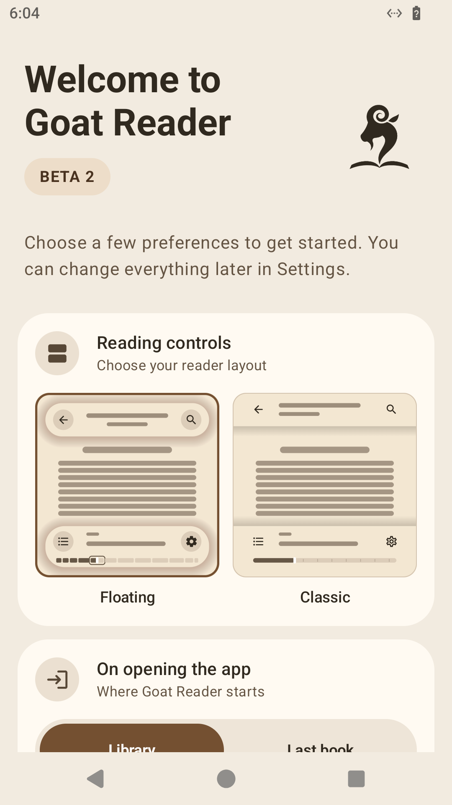<br>Welcome and setup</td>
<td align="center">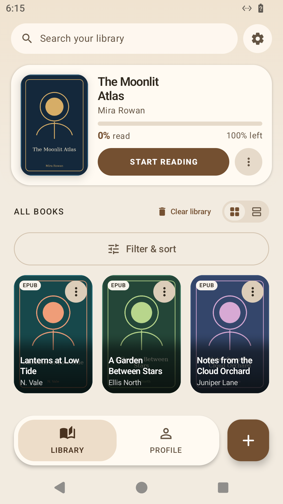<br>Library</td>
</tr>
<tr>
<td align="center">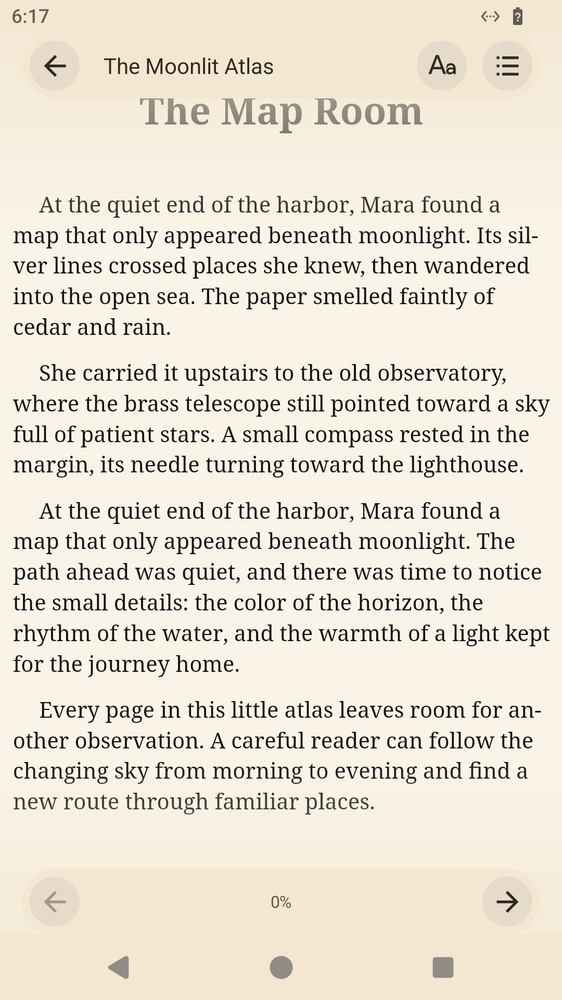<br>Reading view</td>
<td align="center">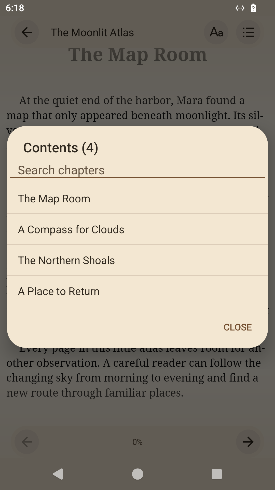<br>Contents</td>
</tr>
<tr>
<td align="center">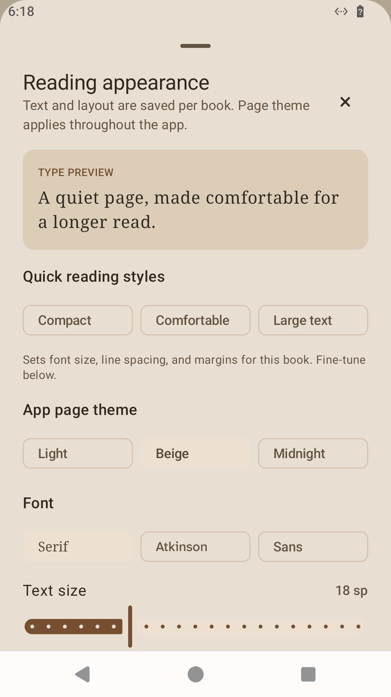<br>Reading appearance</td>
<td align="center">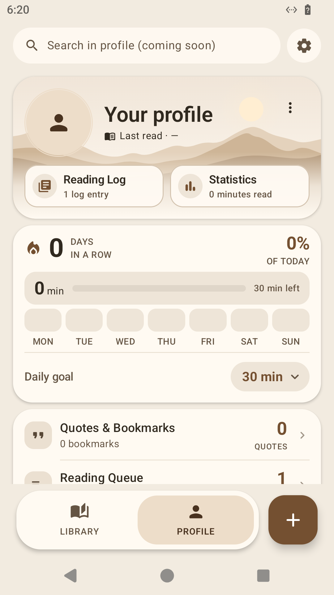<br>Profile</td>
</tr>
<tr>
<td align="center">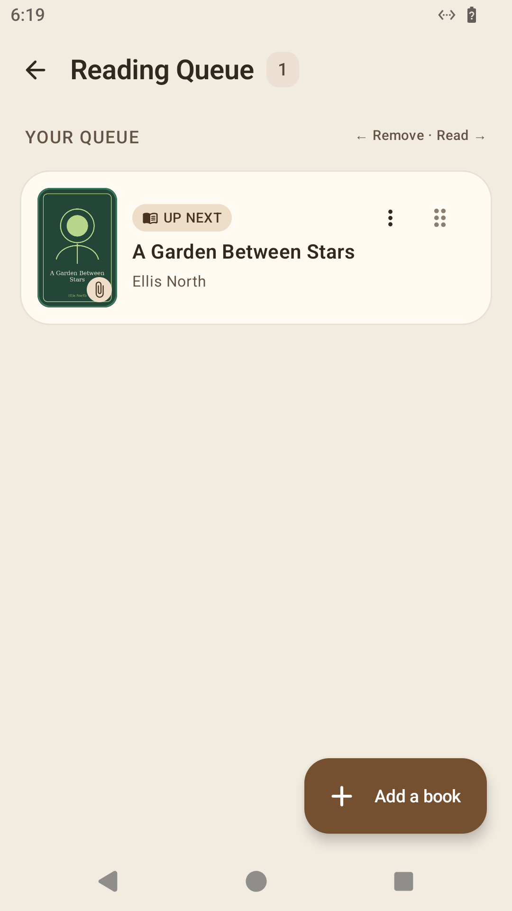<br>Reading queue</td>
<td align="center">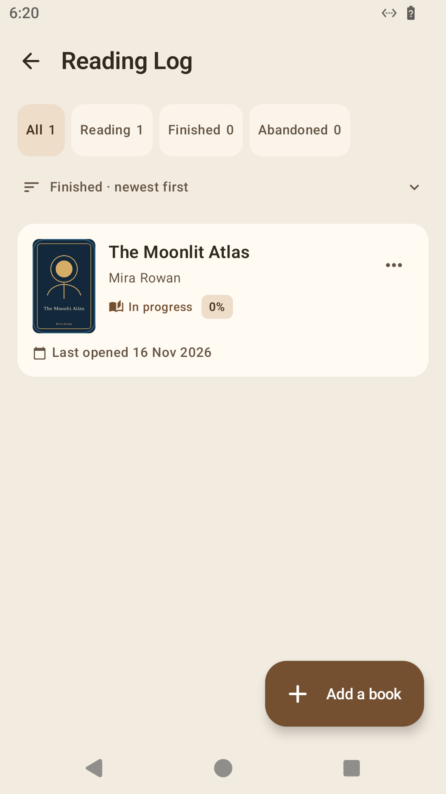<br>Reading log</td>
</tr>
<tr>
<td align="center">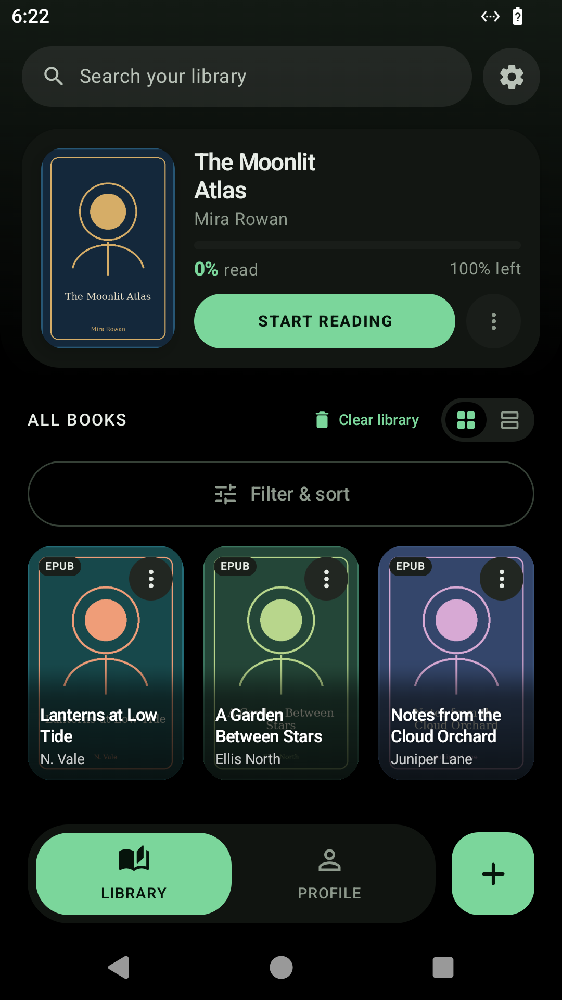<br>Midnight theme</td>
<td align="center">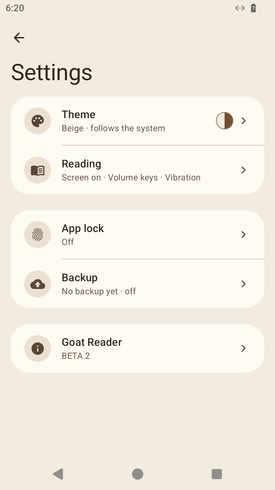<br>Settings</td>
</tr>
<tr>
<td align="center">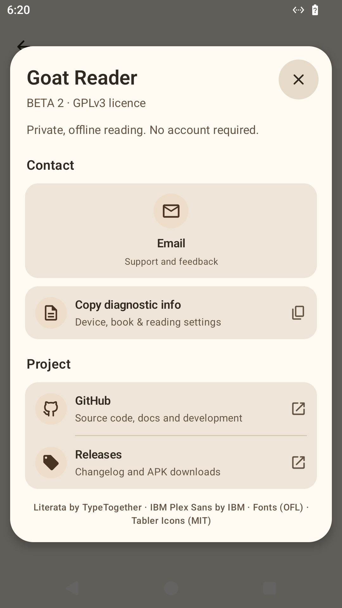<br>About</td>
<td align="center">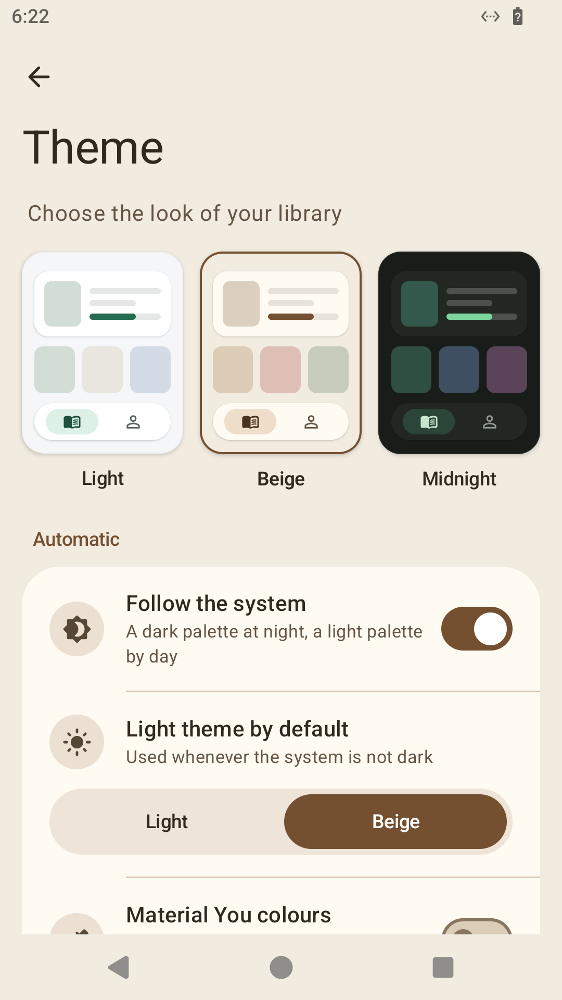<br>Theme options</td>
</tr>
<tr>
<td align="center">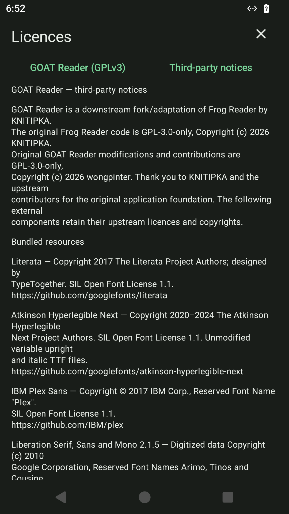<br>Upstream acknowledgment and license notices</td>
</tr>
</table>

## Features

- Library with search, shelves, metadata tools, reading progress and grid/list views.
- EPUB, FB2/FB2 ZIP, MOBI/KF8, TXT and Markdown import and reading, with format- and publication-specific renderer limits.
- Reader appearance and navigation controls; annotation behavior varies by reading engine and format.
- Reading Queue and Reading Log for planning and tracking digital or other reading.
- Offline reading and on-device data, with backup export/import. Core reading requires no account.

PDF, DRM-protected books, KFX and full fixed-layout EPUB/KF8 are not supported. EPUB 3.3 conformance work remains in progress; see [EPUB support notes](docs/epub33-reading-systems-conformance.md).

## Get the app

The public project repository is [github.com/wongpinter/goat-reader](https://github.com/wongpinter/goat-reader). Official release builds, when available, will be listed on its [Releases page](https://github.com/wongpinter/goat-reader/releases).

## Build from source

Requirements: JDK 21 and Android SDK Platform 37. The Gradle wrapper and version catalog pin the build tools.

```sh
git clone https://github.com/wongpinter/goat-reader.git
cd goat-reader
./gradlew test :app:assembleDebug
```

A release build is unsigned by default. See [contributing](CONTRIBUTING.md) and the [release guide](docs/releasing.md) for signing and verification.

## Documentation

See the [documentation index](docs/README.md) for user guides, architecture notes and development references.

## Feedback

- Issues: [github.com/wongpinter/goat-reader/issues](https://github.com/wongpinter/goat-reader/issues)
- Email: [root@wongpinter.com](mailto:root@wongpinter.com)

## License

GOAT Reader is licensed under [GPL-3.0-only](LICENSE). Third-party libraries, fonts and assets retain their own licences; see [third-party notices](THIRD_PARTY_NOTICES.md).

## Acknowledgments

GOAT Reader builds on the original [Frog Reader](https://github.com/KNITIPKA/frog-reader) codebase. Thank you to **KNITIPKA** and the upstream contributors for the application foundation this project continues. Upstream authorship and licensing are documented alongside GOAT Reader contributions in [third-party notices](THIRD_PARTY_NOTICES.md).
